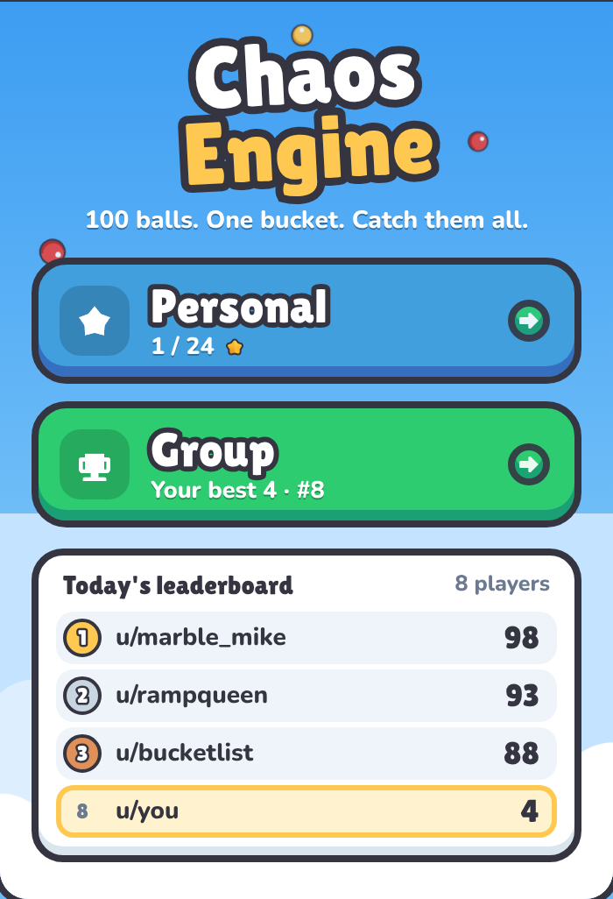
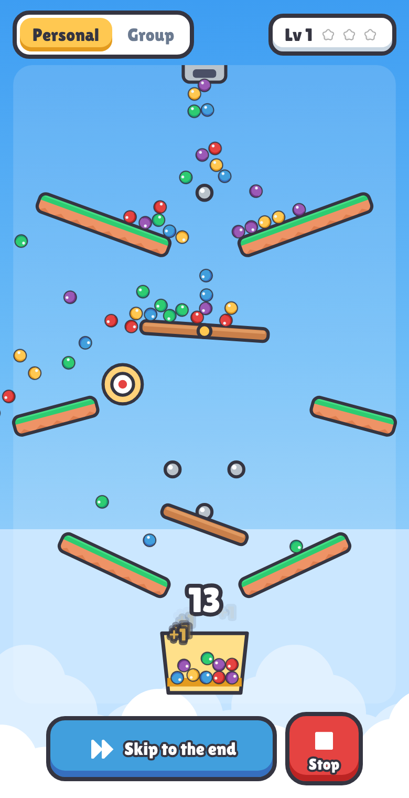
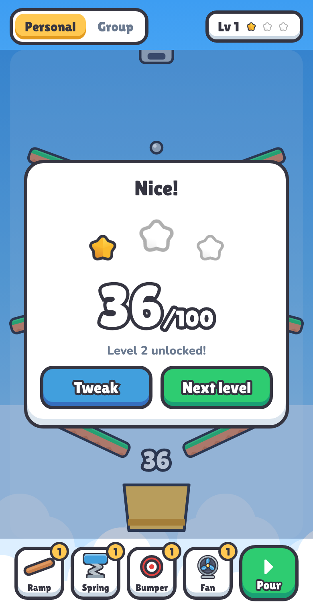
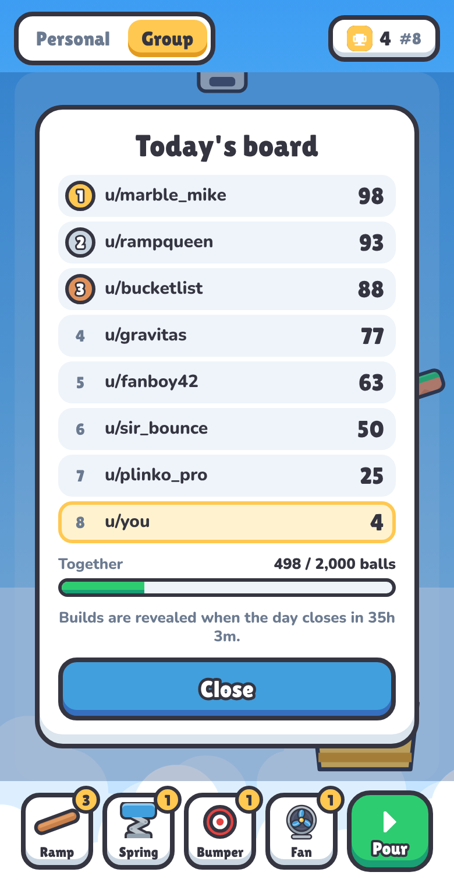

# Chaos Engine

> **100 balls. One bucket. Catch them all.**
> A daily physics puzzle for Reddit with a subreddit leaderboard, built on Devvit Web.

Each machine has a chute at the top, a bucket at the bottom, and ledges, pegs and spinners in between. You get a handful of pieces (ramps, a spring, a bumper, a fan) and you can put them **anywhere**. Press **Pour** and 100 balls tumble through with real physics. Every ball in the bucket counts: **25 for ★, 50 for ★★, 75 for ★★★.**

The post has two buttons:

- **Personal**: levels to beat in order, at your own pace. A star opens the next level. Your stars are saved to your account.
- **Group**: today's machine, the same for the whole subreddit. Your best pour of the day goes on **today's leaderboard** (most balls wins; on a tie, whoever got there first). Every ball anyone catches adds to the subreddit's goal for the day. At **02:00 UTC** the board closes, the winning build is revealed (anyone can watch it pour), a results comment goes up, and the next machine opens. Builds stay hidden until then.

Once you've played Group, the post shows the leaderboard under the two buttons. You can switch between Personal and Group inside the game too.

<p align="center">
  
</p>
<p align="center">
  
  
  
  
</p>

## How to play

1. **Drag a piece** from the bar onto the board. Put it anywhere.
2. **Tap a placed piece to turn it** (ramps and springs 20° a tap, fans 45°). Drag it off the board to take it back.
3. **Pour.** Watch, tweak, pour again. Only your best counts, for stars and for the leaderboard.

| Piece | What it does |
|---|---|
| **Ramp** | A plank. Balls roll along it. |
| **Spring** | Launches any ball that lands on its pad, straight out the way it points. |
| **Bumper** | Kicks balls away hard in whatever direction they hit it. |
| **Fan** | Blows balls along its beam, strongest up close. |

## Fair scores

The phone runs the pour, but the score on the leaderboard comes from the server. Any pour that would raise your best is re-run on the server with the same build, and the server's count is the one that's saved.

That only works if the physics is identical everywhere. The game uses [Matter.js](https://brm.io/matter-js/) at a fixed 1/60 s step, and swaps `Math.sin`, `Math.cos` and `Math.atan2` for deterministic versions while it runs (`src/shared/pour/detmath.ts`). The native ones differ in the last bit between JavaScript engines, and 100 colliding balls turn one bit into a different score. `npm run check:engines` runs the same pours under V8 (Node; Chrome; Android) and JavaScriptCore (Bun; Safari; every iPhone browser) and the ball positions match bit for bit.

Everyone pours the same 100 balls on the same machine, so the only difference between two scores is the build.

## Where the machines come from

Each machine is generated from a seed and then **poured hundreds of times** before it's used (`dev/pour/pack.ts`):

- the empty board catches almost nothing (≤ 15),
- random builds catch almost nothing (median ≤ 20),
- a search that keeps improving a build gets most of the way (≥ 72). People beat the search: on the prototype levels, players beat its best by 10–15.

The machines that pass are split in two: Personal's levels (`personal.json`, easy to hard, including the three hand-made prototype levels) and Group's daily machines (`pack.json`, in play order). No machine is in both, so Personal never gives away a Group day. After the pack runs out it repeats mirrored, then with a different chute wobble, so no two days pour the same. A machine is copied into Redis when its day is created and never changes after that.

## The daily loop

```
OPEN ──02:00 UTC──▶ LOCKED ──▶ RESOLVED ──▶ COMMENTED ──▶ HANDED_OFF (next day OPEN)
```

A scheduler job runs every 10 minutes and advances whatever is due. Each stage saves its own state and is safe to repeat, so a crash in the middle just picks up on the next run. Posts and comments are found again by their title marker before anything new is created, so nothing is posted twice.

The daily goal is 10% more than the subreddit caught the day before (at least 2,000 balls). Days in a row with the goal met are the subreddit's streak.

## Moderator menu

| Item | What it does |
|---|---|
| Run now | Close today's machine now, post results, open the next one. |
| New post for today | Recreate today's post if it was deleted. |
| Remove a score… | Take a player off today's leaderboard. |
| How hard is today? | What the generator's own search caught on today's machine. |
| Show duplicates | Duplicate posts or comments to clean up. |

## Project layout

```
src/shared/pour/   physics (sim.ts), deterministic trig, build checks, generator, search, the pack
src/server/        Hono routes, daily pipeline, leaderboard (core/board.ts), results
src/client/pour/   game screen (game.ts), canvas drawing, sounds
src/client/splash/ the feed card
dev/demo/          browser playtest: the real server running in the page over an in-memory store
dev/pour/          machine search, pack builder, cross-engine check, machine gallery
```

## Develop

```bash
npm install
npm run check          # lint, typecheck, tests, build
npm run demo:build     # browser playtest → dist/demo
npm run check:engines  # V8 vs JavaScriptCore, needs bun
npm run pack           # search for more machines (slow; uses 4 cores)
npm run pack:json      # rebuild pack.json from the search results
```

Art: [Kenney](https://kenney.nl) (CC0). Fonts: Lilita One, Nunito (OFL). Physics: Matter.js (MIT).
