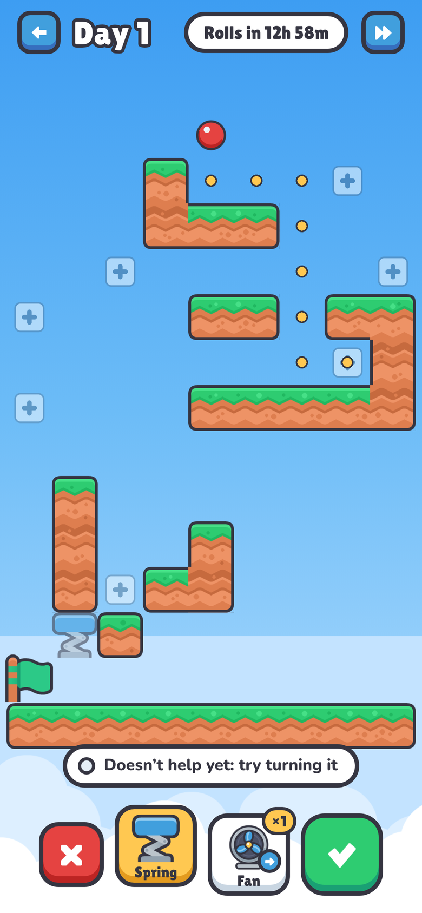

# Chaos Engine

> **Build together. Let chaos take over.**
> A daily cooperative machine-building game for Reddit, built on Devvit Web.

Every day your subreddit gets **one shared machine** with a red ball and a green flag. Everyone adds pieces (ramps, springs and fans) to get the ball to the flag. Press ▶ as often as you like to test. At **02:00 UTC** the machine rolls **three balls**: the red one you've been testing, plus **two surprise balls** that behave a little differently. **Each ball that reaches the flag is a ⭐**, and a new machine opens the same minute.

<p align="center">
  
</p>
<p align="center">
  
  
  
</p>

## How to play

1. **Get the ball to the flag.**
2. **Tap a +** to add a piece. The tray shows the pieces today's machine has; tap the chosen piece again to turn it. Dotted yellow is where the ball will go with your piece. Tap ✓ to place it.
3. **Press ▶** to watch the ball roll. Test as often as you like.
4. **At 02:00 UTC** three balls roll for real. Each one that reaches the flag is a star: ⭐⭐⭐ is a perfect day.

Everyone builds the same machine. You can't make it worse: a piece that would send the red ball less far isn't allowed, and you can only replace someone's piece with one that does better.

### Solo and community

There's no mode to pick. Today's fix needs 2–4 pieces, shared between everyone building today, rounded up: **pieces you can place = pieces needed ÷ people building**. Alone, you can build the whole fix; on a busy day it's one piece each. At your limit, tapping another + moves your piece there.

### The pieces

| Piece | Turns | What it does |
|---|---|---|
| **Ramp** | ↘ ↙ | Sends the ball down and to the side. |
| **Spring** | ↑ ↗ ↖ | Launches a ball that lands on it, straight up or in an arc. |
| **Fan** | → ← ↑ | Blows the ball along (you can see the wind), up to 3 squares. |

Each day has exactly the pieces its solution needs, and every weekday features a different one (springs or fans), so no two days play the same. The machine also has **switches** that unlock **gates**, and on Saturdays numbered **coins** to collect in order.

### The surprise balls

Balls 2 and 3 are two of these, each with its own colour:

| Ball | What's different |
|---|---|
| 🔵 **Lefty / Righty** | Starts one step to the side. |
| ⚪ **Heavy** | Hard to push or launch. |
| 🟢 **Bouncy** | Springs fling it higher. |
| 🟣 **Backwards** | Rolls the other way. |
| 🟡 **Slick** | Slides over ramps. |

Build so it works for more than just the red ball.

### How fairness works (the seal)

When a Day opens, the server draws a random 32-byte secret and publishes `sha256(secret)` in the game ("🔒 Sealed: 3fa9…"). The secret balls are picked deterministically from `hash(dayId + secret)`. At lock the secret is revealed and the game checks the hash in front of you ("sha256(seed) = … ✓ matches"). Everything else is deterministic too: replays are recomputed from the frozen board and the revealed seed, with integer-only physics.

### Awards and stats

- 🏆 **MVP**: the piece whose removal would have hurt the day's outcome most (computed by re-running the day without it).
- 👆 **Most touched**: the piece the balls hit most often across all three runs.
- ⏱ **Clutch**: the last placement before lock that improved Ball 1's progress.
- **Community**: current streak of Days with at least one star, best streak, perfect (⭐⭐⭐) Days.
- **You**: pieces placed, pieces that touched a ball in the final run, MVPs.

Awards are positive only; nobody is ever named as a "saboteur". If something happened to your piece while you were away (someone replaced it, or it became MVP), the game tells you the next time you open it.

### The weekly rhythm

| Day | Difficulty | Twist |
|---|---|---|
| Mon, Tue | ⚙ | 2-piece fix |
| Wed, Thu | ⚙⚙ | 3-piece fix, gates likely |
| Fri | ⚙⚙⚙ | 4-piece fix, a gate guaranteed |
| Sat | ⚙⚙⚙ | Checkpoints: hit ①② in order before the goal |
| Sun | ⚙⚙ | Springs and fans |

## For moderators

Install the app, and Day 1 opens with its own post (the app makes every post itself). A scheduled job runs every 10 minutes: at the lock time (**02:00 UTC**, once a day) it locks the machine, resolves the three balls, posts a results comment, and opens the next Day's post. Every stage is crash-safe and idempotent, and the job searches for its own posts and comments before creating any, so a retry never duplicates them.

Moderator menu items (subreddit menu → **Chaos Engine: …**):

| Item | What it does |
|---|---|
| **Seed demo day** | Fills today's machine with labelled `(setup)` pieces (all but one piece of a known solution) Great for a fresh subreddit. Players can replace setup pieces under the improve rule. |
| **Run now** | Locks and resolves today's machine immediately, then opens the next one (same code path as the scheduler). |
| **New post for today** | Recreates today's post if it was deleted. |
| **Remove piece…** | Moderation override: remove the piece at a coordinate (e.g. `C7`). It returns to stock and its owner is notified. |
| **Regenerate upcoming** | Rebuilds unpinned future machines with the current generator version. |
| **Show today's solution** | Shows the generator's known solution (debugging aid; never sent to players). |
| **Show duplicates** | Lists duplicate posts/comments recorded during recovery, for cleanup. |

The app makes **no external network requests** (its HTTP allowlist is empty).

## Development

```bash
npm install
npm run check      # lint + typecheck + tests + Devvit build
npm run harness    # local harness on http://localhost:5174 (no Reddit account needed)
npm run dev        # devvit playtest (needs `devvit login`)
```

The **local harness** runs the real server routes against an in-memory Redis (with `watch/multi/exec`) and a fake Reddit. It provides a phone frame, a user switcher, **Advance day**, **Seed demo**, a **sandbox** for placing pieces freely, and a **seed gallery** of the next 30 generated Days. The gallery has a "Play solution" button and lets you pin a different validated attempt for any future Day.

<p align="center"></p>

Project layout: `src/shared` (pure, deterministic simulation, generator, rules), `src/server` (Hono routes and the daily pipeline over injected ports), `src/client` (`splash.html` inline card without Phaser; `game.html` with a Phaser board and a DOM overlay), `dev/harness`, `tests` (Vitest). See [`PLAN.md`](PLAN.md) for the full design and [`DECISIONS.md`](DECISIONS.md) for choices made during the build.
