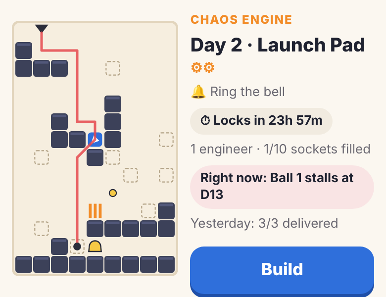
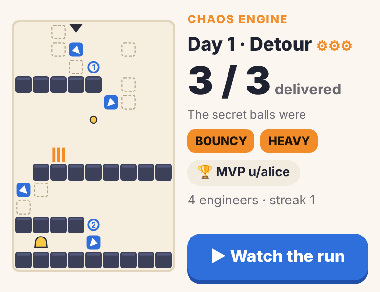
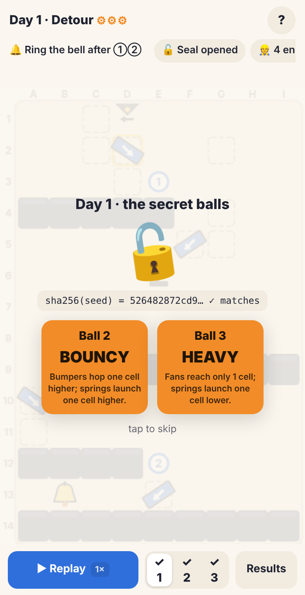
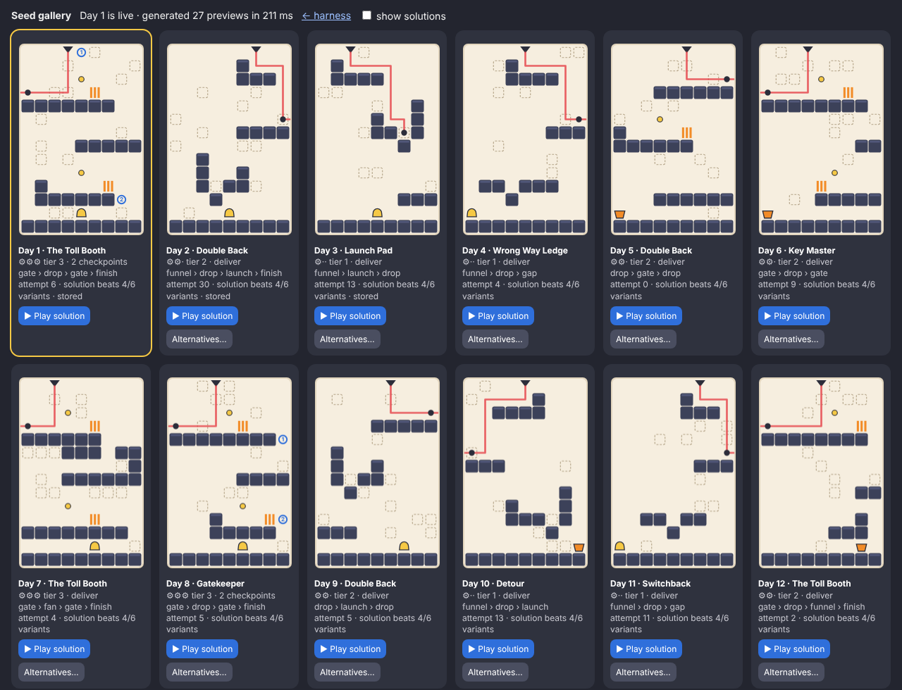

# Chaos Engine

> **Build together. Let chaos take over.**
> A daily cooperative machine-building game for Reddit, built on Devvit Web.

Every day your subreddit gets **one shared, broken machine**. Everyone can add **one piece**: a ramp, spring, fan or bumper. Run the machine as often as you like to see what your piece does. At the daily lock the machine fires **three balls**: the standard ball you've been testing, plus **two secret variants** sealed with a published hash. The community scores 0–3, awards go to the pieces that mattered, and a fresh, procedurally generated machine opens the same minute.

<p align="center">
  
  
</p>
<p align="center">
  
  
  
</p>

## Why it's different

- **One cooperative machine per day.** No per-player boards, no PvP. The subreddit wins or loses together.
- **Griefing is impossible by rule.** A piece can never lower the standard ball's progress, and you can only replace someone else's piece with a strictly better one. There's no voting.
- **Secret balls with a provable seal.** The two variants are drawn from a random seed whose SHA-256 is shown when the Day opens. The seed is revealed at lock, so anyone can check nothing was changed after seeing your pieces.
- **A new machine every day, proven solvable.** Machines are generated from parameterised "bands", built solved and then broken, and validated before they go live. There's no hand-made level list to run out of.
- **Everyone has something to do.** Builders place pieces; everyone else can predict the score, inspect who placed what, and argue about coordinates (C7, F4) in the comments.

## How to play

1. **Open today's post** and tap **Build**.
2. **▶ Test run** shows what Ball 1 does right now. Runs are free and instant, so use as many as you like.
3. **Tap a dashed socket** to add your piece. Tap a piece type to pick it, then tap it again to turn it. A **ghost preview** shows the old path faded and the new path bright, plus a verdict:
   - `Better progress ✓`: Ball 1 gets further.
   - `Same progress ✓`: Ball 1 does the same (maybe your piece is dormant… for now).
   - `Lower progress ✗`: not allowed. The reason is spelled out, e.g. *"Ball 1 now falls into the void at E9 instead of reaching checkpoint ②."*
4. **Confirm.** You hold one piece at a time, and you can move it, turn it, swap its type or remove it until lock.
5. **🔮 Predict** how many of the three balls will make it (0–3). You can change it until lock.
6. **At lock** the seal opens, the two secret variants are revealed, and all three balls fire. Watch the replay, see the awards, then head to the newest post for tomorrow's machine.

> **Only Ball 1's progress is protected, not whether the machine will win.** The secret balls can be helped, or hurt, by any piece.

### The rules

| You hold | You tap | What happens | Allowed if Ball 1's progress… |
|---|---|---|---|
| nothing | an empty socket | **Place** | doesn't drop |
| nothing | someone else's piece | **Replace**: theirs is removed and they may place again | strictly improves |
| a piece | an empty socket | **Move** | doesn't drop |
| a piece | your own piece | **Turn or swap type** | doesn't drop |
| a piece | someone else's piece | **Move and replace** | strictly improves |
| a piece | Remove | **Remove** | doesn't drop |
| anything | a wall, gate, switch, target… | not allowed: the machine itself can't be changed | — |

Each Day has limited **stock** of each piece type. Removed or replaced pieces go back into stock.

**Progress** is compared in order: did the ball deliver? → how many checkpoints did it hit, in order? → how close did it get to the goal (measured on the machine's fixed walls)?

### The pieces

| Piece | Orientations | What it does |
|---|---|---|
| **Ramp** | ↘ ↙ | The ball passes through; it is sent diagonally down (or sideways) in the ramp's direction. |
| **Spring** | ↑ ↗ ↖ | Launches a ball that lands on it. ↑ goes straight up 3 (and one step on if the ball was rolling); ↗/↖ throw an arc 4 columns wide. |
| **Fan** | → ← ↑ | A solid block that blows a beam 3 cells long. Side fans push rolling balls and blow falling ones sideways; ↑ fans lift the ball and let it slip out at the top. |
| **Bumper** | ▶ ◀ | Solid. Bounces a ball that hits it from the side back with a hop; a ball landing on it is kicked toward the bumper's side. |

The machine also has **walls**, **switches** (toggle linked gates the first time a ball passes), **gates**, **checkpoints** ①②③ (Saturdays: hit them in order before the goal counts) and the **goal** (a bell or a basket).

### The six secret variants

Balls 2 and 3 are two different variants from this public list:

| Variant | Effect |
|---|---|
| **Drifter (left)** | Spawns one column left of the start. |
| **Drifter (right)** | Spawns one column right of the start. |
| **Heavy** | Fans reach only 1 cell; springs launch one cell lower. |
| **Bouncy** | Bumpers hop one cell higher; springs launch one cell higher. |
| **Contrarian** | Starts rolling the opposite way. |
| **Slick** | Ramps push it sideways only, with no diagonal drop. |

Build for robustness: the machine that only works for Ball 1 rarely scores 3/3.

### How fairness works (the seal)

When a Day opens, the server draws a random 32-byte secret and publishes `sha256(secret)` in the game ("🔒 Sealed: 3fa9…"). The secret balls are picked deterministically from `hash(dayId + secret)`. At lock the secret is revealed and the game checks the hash in front of you ("sha256(seed) = … ✓ matches"). Everything else is deterministic too: replays are recomputed from the frozen board and the revealed seed, with integer-only physics.

### Awards and stats

- 🏆 **MVP**: the piece whose removal would have hurt the day's outcome most (computed by re-running the day without it).
- 👆 **Most touched**: the piece the balls hit most often across all three runs.
- ⏱ **Clutch**: the last placement before lock that improved Ball 1's progress.
- **Community**: current streak of Days with at least one delivery, best streak, perfect (3/3) Days.
- **You**: pieces placed, pieces that touched a ball in the final run, MVPs, prediction streak.

Awards are positive only; nobody is ever named as a "saboteur". If something happened to your piece while you were away (someone replaced it, or it became MVP), the game tells you the next time you open it.

### The weekly rhythm

| Day | Difficulty | Twist |
|---|---|---|
| Mon, Tue | ⚙ | 2-piece fix |
| Wed, Thu | ⚙⚙ | 3-piece fix, gates likely |
| Fri | ⚙⚙⚙ | 4-piece fix, a gate guaranteed |
| Sat | ⚙⚙⚙ | Checkpoints: hit ①② in order before the goal |
| Sun | ⚙⚙ | Springs and fans |

## For moderators

Install the app, and Day 1 opens with its own post. A scheduled job runs every 10 minutes: at the lock time (12:00 UTC by default) it locks the machine, resolves the three balls, posts a results comment, and opens the next Day's post. Every stage is crash-safe and idempotent, and the job searches for its own posts and comments before creating any, so a retry never duplicates them.

Moderator menu items (subreddit menu → **Chaos Engine: …**):

| Item | What it does |
|---|---|
| **Seed demo day** | Fills today's machine with labelled `(setup)` pieces (all but one piece of a known solution) and demo predictions. Great for a fresh subreddit. Players can replace setup pieces under the improve rule. |
| **Run now** | Locks and resolves today's machine immediately, then opens the next one (same code path as the scheduler). |
| **New post for today** | Recreates today's post if it was deleted. |
| **Remove piece…** | Moderation override: remove the piece at a coordinate (e.g. `C7`). It returns to stock and its owner is notified. |
| **Regenerate upcoming** | Rebuilds unpinned future machines with the current generator version. |
| **Show today's solution** | Shows the generator's known solution (debugging aid; never sent to players). |
| **Show duplicates** | Lists duplicate posts/comments recorded during recovery, for cleanup. |

The app makes **no external network requests** (its HTTP allowlist is empty).

## Development

```bash
npm install
npm run check      # lint + typecheck + tests + Devvit build
npm run harness    # local harness on http://localhost:5174 (no Reddit account needed)
npm run dev        # devvit playtest (needs `devvit login`)
```

The **local harness** runs the real server routes against an in-memory Redis (with `watch/multi/exec`) and a fake Reddit. It provides a phone frame, a user switcher, **Advance day**, **Seed demo**, a **sandbox** for placing pieces freely, and a **seed gallery** of the next 30 generated Days. The gallery has a "Play solution" button and lets you pin a different validated attempt for any future Day.

<p align="center"></p>

Project layout: `src/shared` (pure, deterministic simulation, generator, rules), `src/server` (Hono routes and the daily pipeline over injected ports), `src/client` (`splash.html` inline card without Phaser; `game.html` with a Phaser board and a DOM overlay), `dev/harness`, `tests` (Vitest). See [`PLAN.md`](PLAN.md) for the full design and [`DECISIONS.md`](DECISIONS.md) for choices made during the build.
