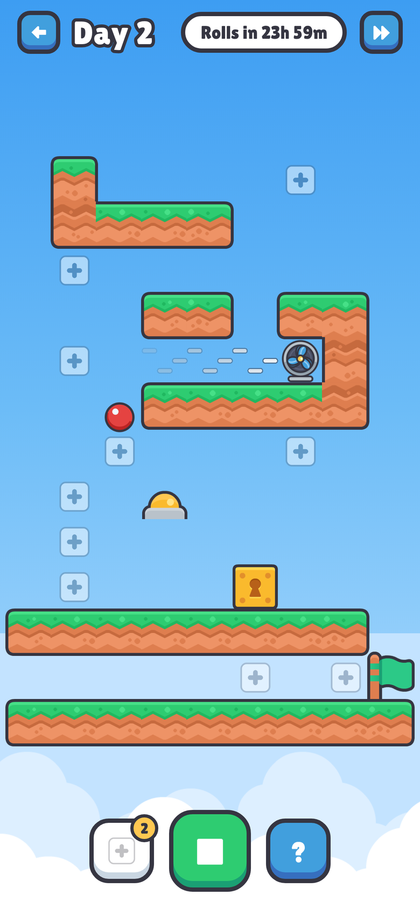

# Chaos Engine

> **Build together. Let chaos take over.**
> A daily cooperative machine-building game for Reddit, built on Devvit Web.

Every day your subreddit gets a **Build of the Day**: one machine with a ball chute and a green flag. Open the post and pick how to play:

- **Solo** — your own machine for the day with every piece it has. Place the pieces, press ▶ and three balls roll: **normal, heavy and bouncy**. Each one that reaches the flag is a ⭐, and coloured dots show where each ball went. Try as often as you like (hints after 3 tries); your best is saved.
- **Team** — a different machine (so Solo answers don't spoil it), one board for the whole subreddit. The pieces are split between today's builders, nobody can make it worse, and at **02:00 UTC** the three balls roll for real. Then a new machine opens.

<p align="center">
  
</p>
<p align="center">
  
  
  
</p>

## How to play

1. **Get the balls to the flag.**
2. **Tap a +**: a bubble shows the pieces you have. Tap one to place it; tap a placed piece to turn or remove it. There's no preview: you find out by rolling.
3. **Press ▶** to roll all three balls. Coloured dots show where each ball went and a ✕ where it was lost. Build so the heavy and bouncy balls make it too.

### The three balls

| Ball | What's different |
|---|---|
| 🔴 **Normal** | The one the dotted path shows. |
| ⚪ **Heavy** | Fans push it less; springs throw it lower. |
| 🟢 **Bouncy** | Springs throw it higher. |

They're the same three every day. Every machine is checked by trying every possible arrangement of its pieces: at least one gets all three home, at most 2% of arrangements win (no winning by luck), and at least 30% of builds that get the normal ball home still lose the heavy or bouncy one (so all three balls matter).

### Team play: how pieces are shared

Today's fix needs 2–4 pieces. They're split between everyone building today, rounded up: **pieces you can place = pieces needed ÷ people building**. Alone, you can build the whole fix; with four people on a four-piece day it's one each. A piece can only be replaced by one that gets the normal ball further, so nobody can wreck the board. In Team, ▶ shows what the board would score if it rolled right now.

### The pieces

| Piece | Turns | What it does |
|---|---|---|
| **Ramp** | ↘ ↙ | Sends the ball down and to the side. |
| **Spring** | ↑ ↗ ↖ | Launches a ball that lands on it, straight up or in an arc. |
| **Fan** | → ← ↑ | Blows the ball along (you can see the wind), up to 3 squares. |

Each day has exactly the pieces its solution needs, and every weekday features a different one (springs or fans), so no two days play the same. The machine also has **switches** that unlock **gates**, and on Saturdays numbered **coins** to collect in order.

### How fairness works (the seal)

When a Day opens, the server draws a random 32-byte secret and publishes `sha256(secret)` in the game ("🔒 Sealed: 3fa9…"). The secret balls are picked deterministically from `hash(dayId + secret)`. At lock the secret is revealed and the game checks the hash in front of you ("sha256(seed) = … ✓ matches"). Everything else is deterministic too: replays are recomputed from the frozen board and the revealed seed, with integer-only physics.

### Awards and stats

- 🏆 **MVP**: the piece whose removal would have hurt the day's outcome most (computed by re-running the day without it).
- 👆 **Most touched**: the piece the balls hit most often across all three runs.
- ⏱ **Clutch**: the last placement before lock that improved Ball 1's progress.
- **Community**: current streak of Days with at least one star, best streak, perfect (⭐⭐⭐) Days.
- **You**: pieces placed, pieces that touched a ball in the final run, MVPs.

Awards are positive only; nobody is ever named as a "saboteur". If something happened to your piece while you were away (someone replaced it, or it became MVP), the game tells you the next time you open it.

### The weekly rhythm

| Day | Difficulty | Twist |
|---|---|---|
| Mon, Tue | ⚙ | 2-piece fix |
| Wed, Thu | ⚙⚙ | 3-piece fix, gates likely |
| Fri | ⚙⚙⚙ | 4-piece fix, a gate guaranteed |
| Sat | ⚙⚙⚙ | Checkpoints: hit ①② in order before the goal |
| Sun | ⚙⚙ | Springs and fans |

## For moderators

Install the app, and Day 1 opens with its own post (the app makes every post itself). A scheduled job runs every 10 minutes: at the lock time (**02:00 UTC**, once a day) it locks the machine, resolves the three balls, posts a results comment, and opens the next Day's post. Every stage is crash-safe and idempotent, and the job searches for its own posts and comments before creating any, so a retry never duplicates them.

Moderator menu items (subreddit menu → **Chaos Engine: …**):

| Item | What it does |
|---|---|
| **Seed demo day** | Fills today's machine with labelled `(setup)` pieces (all but one piece of a known solution) Great for a fresh subreddit. Players can replace setup pieces under the improve rule. |
| **Run now** | Locks and resolves today's machine immediately, then opens the next one (same code path as the scheduler). |
| **New post for today** | Recreates today's post if it was deleted. |
| **Remove piece…** | Moderation override: remove the piece at a coordinate (e.g. `C7`). It returns to stock and its owner is notified. |
| **Regenerate upcoming** | Rebuilds unpinned future machines with the current generator version. |
| **Show today's solution** | Shows the generator's known solution (debugging aid; never sent to players). |
| **Show duplicates** | Lists duplicate posts/comments recorded during recovery, for cleanup. |

The app makes **no external network requests** (its HTTP allowlist is empty).

## Development

```bash
npm install
npm run check      # lint + typecheck + tests + Devvit build
npm run harness    # local harness on http://localhost:5174 (no Reddit account needed)
npm run dev        # devvit playtest (needs `devvit login`)
```

The **local harness** runs the real server routes against an in-memory Redis (with `watch/multi/exec`) and a fake Reddit. It provides a phone frame, a user switcher, **Advance day**, **Seed demo**, a **sandbox** for placing pieces freely, and a **seed gallery** of the next 30 generated Days. The gallery has a "Play solution" button and lets you pin a different validated attempt for any future Day.

<p align="center"></p>

Project layout: `src/shared` (pure, deterministic simulation, generator, rules), `src/server` (Hono routes and the daily pipeline over injected ports), `src/client` (`splash.html` inline card without Phaser; `game.html` with a Phaser board and a DOM overlay), `dev/harness`, `tests` (Vitest). See [`PLAN.md`](PLAN.md) for the full design and [`DECISIONS.md`](DECISIONS.md) for choices made during the build.
